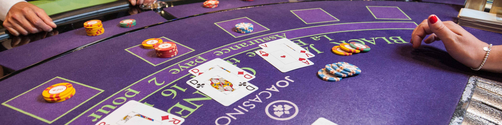

<p align="center">
  
</p>

# Blackjack policy by Monte Carlo with exploring starts

Five million hands of self-play produce a policy worth -0.0368 per hand to the player, across the 280
states the game has once the cards on the table are reduced to what matters: the player's total,
whether an ace is still counted as eleven, and the dealer's face-up card. That loss rate is what a
player should expect when the only two choices are hit and stand.

The number is worse than the half a per cent a casino usually quotes, and the reason is the rule set
rather than the method. Doubling down and splitting pairs are not in this game. Those are the two
moves that let a player press an advantage when the dealer is weak, and without them the house keeps
most of its edge.


## How it works

**The method.** Monte Carlo control with exploring starts. Play a hand to the end, note what it
returned, then update the estimated value of every state-action pair that occurred along the way
toward that return. The policy becomes greedy with respect to those estimates. No model of the deck
is used anywhere; everything is learned from hands played.

The exploring starts part matters. Each hand begins from a randomly chosen state and a randomly
chosen first action, so every state-action pair keeps getting sampled even after the policy has
stopped choosing it. Without that, the estimates for actions the policy has abandoned go stale, and
the policy can settle on something that merely looks good because the alternative was never tried
again.

**Why Monte Carlo and not temporal difference.** A hand of blackjack ends quickly and the reward
arrives only at the end. There is no bootstrapping to gain from, because the value of an intermediate
state is nothing more than the average outcome of the hands that pass through it. Waiting for the
real return avoids the bias that comes from updating one estimate toward another estimate.

**The state.** Player total from 12 to 21, dealer card from ace to ten, and a flag for whether the
player holds an ace that can still count as eleven without busting. Totals under 12 need no decision,
since hitting cannot bust. That gives the 280 states reported above.

## Running it

```bash
pip install -r requirements.txt
python solve.py
```

Five million episodes take a few minutes and write the policy map to `results/`.

## Limits

- Hit and stand only. No doubling, no splitting, no surrender, no insurance.
- The deck is drawn with replacement, so cards are independent from hand to hand. That removes card
  counting entirely, which is the one thing that moves blackjack from a losing game to a winnable one.
- Dealer behaviour is fixed, standing on all 17s.
- The policy is the output. Nothing here plays against a real casino rule set.

## References

1. Sutton, R. S. & Barto, A. G. (2018). *Reinforcement Learning: An Introduction*, 2nd edition. MIT
   Press. Blackjack is the worked example for Monte Carlo control with exploring starts.
2. Thorp, E. O. (1966). *Beat the Dealer*. Random House.

## License

MIT License. See [LICENSE](LICENSE).
